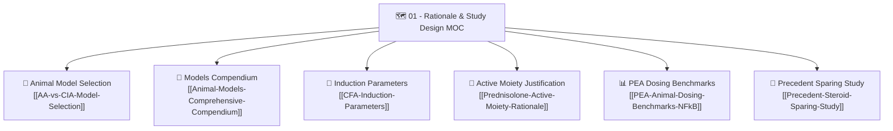

# 🗺️ Map of Content (MOC): 01 — Rationale & Study Design

> **Thematic Hub:** Foundational justifications, comparative animal model selection, active glucocorticoid moiety selection, and pharmacological dosage rationales.

---

## 📌 Core Navigational Structure

---

## 📑 Detailed Note Index & Scientific Roles

1. **[[AA-vs-CIA-Model-Selection|Adjuvant Arthritis (AA) vs. Collagen-Induced Arthritis (CIA) Selection]]**  
   *Scope:* Detailed comparative analysis justifying why Complete Freund's Adjuvant (CFA) arthritis in female Wistar rats was selected over CIA (reproducibility, clear timeline, robust systemic inflammation, absence of genetic restriction).
2. **[[Animal-Models-Comprehensive-Compendium|Comprehensive Compendium of RA Animal Models]]**  
   *Scope:* Complete taxonomy extracted from Dr. Refaat's source document `Adjuvants.docx`, reviewing AA, CIA, AIA, SIA, and CAIA with full chemical handling protocols for CFA.
3. **[[CFA-Induction-Parameters|CFA Induction Parameters & Disease Trajectory]]**  
   *Scope:* Exact injection parameters (0.3 mL s.c. in right inguinal region), incubation kinetics (Days 1–15), systemic polyarthritis onset, and scoring metrics.
4. **[[Prednisolone-Active-Moiety-Rationale|Prednisolone Active Moiety Justification Over Prednisone]]**  
   *Scope:* Pharmacokinetic and enzymatic justification from `Rational choices.docx`. Explains why direct Prednisolone bypasses hepatic 11β-HSD1 downregulation in severe inflammation and details steroid toxicity mitigation (osteoporosis, hyperglycemia, HPA shutdown).
5. **[[PEA-Animal-Dosing-Benchmarks-NFkB|PEA Animal Dosing Benchmarks in Inflammatory Pain]]**  
   *Scope:* In vivo dose-response titration across literature, validating 50, 100, and 200 mg/kg p.o. as the optimal tiers for maximal NF-κB transrepression.
6. **[[Precedent-Steroid-Sparing-Study|Precedent Steroid-Sparing Nanoparticle Studies]]**  
   *Scope:* Foundational analysis of co-delivery systems demonstrating $>50\%$ glucocorticoid dose reduction without loss of anti-inflammatory efficacy.

---

## 🔗 Bidirectional Second Brain Connections
- Parent Hub: [[Home-Index]]
- Next Domain Hub: [[02-MOC-Molecular-Mechanisms]]
- Protocol Execution: [[Official-Institutional-Protocol-Final]]
