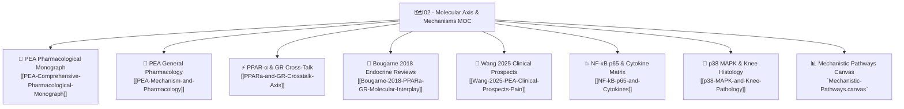

# 🗺️ Map of Content (MOC): 02 — Molecular Axis & Mechanisms

> **Thematic Hub:** Receptor pharmacology, molecular signaling cascades, cross-talk between PPAR-α and the Glucocorticoid Receptor, and histopathological joint degradation pathways.

---

## 📌 Core Navigational Structure

---

## 📑 Detailed Note Index & Scientific Roles

1. **[[PEA-Comprehensive-Pharmacological-Monograph|Palmitoylethanolamide (PEA): Comprehensive Pharmacological Monograph]]**  
   *Scope:* Full chemical identity, endogenous biosynthesis (NAPE-PLD), NAAA/FAAH hydrolysis, ALIAmide mast cell stabilization, PPAR-α agonism, and micronization kinetics.
2. **[[PEA-Mechanism-and-Pharmacology|PEA Mechanism & In-Depth Pharmacology]]**  
   *Scope:* Extended review of GPR55, CB2 entourage effect, and TRPV1 calcium-dependent desensitization in chronic synovial pain.
3. **[[PPARa-and-GR-Crosstalk-Axis|PPAR-α and Glucocorticoid Receptor Cross-Talk Axis]]**  
   *Scope:* The theoretical centerpiece of Dr. Refaat's Master's Thesis from `GR and PPAR-a.docx`: the dual-clamp suppression model, transactivation of IκBα, and Annexin A1 potentiation.
4. **[[Bougarne-2018-PPARa-GR-Molecular-Interplay|Bougarne et al. (2018): Molecular Actions & Interplay of GR and PPARα]]**  
   *Scope:* Foundational *Endocrine Reviews* paper detailing non-canonical PPRE-independent IκBα induction, MED1/DRIP205 and Sp1 coactivator recruitment, and promoter priming.
5. **[[Wang-2025-PEA-Clinical-Prospects-Pain|Wang et al. (2025): PEA in the Treatment of Pain & Clinical Prospects]]**  
   *Scope:* State-of-the-art clinical review summarizing human trial safety across $>4,000$ patients, clinical dosing ($600–1200\text{ mg/day}$), and steroid-sparing efficacy.
6. **[[NF-kB-p65-and-Cytokines|NF-κB p65 Activation Cascade & Cytokine Matrix]]**  
   *Scope:* Classical canonical NF-κB pathway, IKK phosphorylation, p65 nuclear import, and quantitative ELISA targets (TNF-α, IL-1β, IL-6, ACPA).
7. **[[p38-MAPK-and-Knee-Pathology|p38 MAPK Signaling & Histopathological Joint Destruction]]**  
   *Scope:* Kinase phosphorylation dynamics (Thr180/Tyr182), dual MKP-1 (DUSP1) phosphatase induction by PEA + Prednisolone, and Safranin-O cartilage histomorphometry.
8. **`02 - Molecular Axis & Mechanisms/Mechanistic-Pathways.canvas` (Interactive Visual Map)**  
   *Scope:* Visual node-and-edge layout mapping the flow of intracellular signaling from cell surface receptors to nuclear transcription and joint tissue endpoints.

---

## 🔗 Bidirectional Second Brain Connections
- Previous Domain Hub: [[01-MOC-Rationale-and-Study-Design]]
- Next Domain Hub: [[03-MOC-Literature-Matrix]]
- Protocol Application: [[Main-Protocol-7-Groups]]
- Thesis Defense Deck: [[Thesis-Defense-Deck-Complete]]
