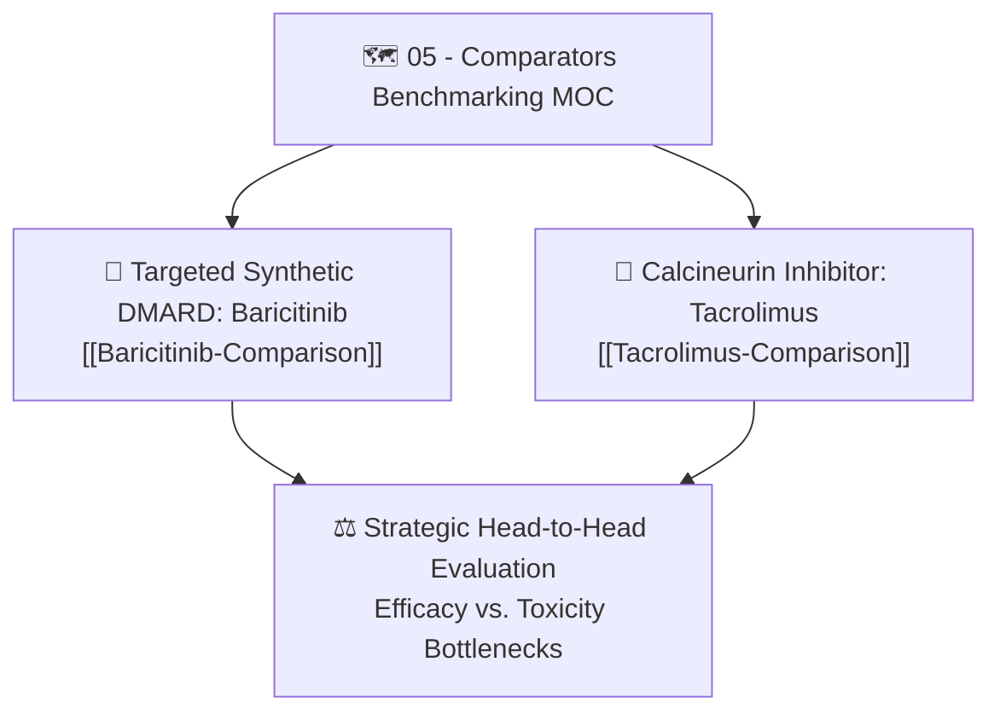

# 🗺️ Map of Content (MOC): 05 — Comparators Benchmarking

> **Thematic Hub:** Targeted synthetic DMARDs (tsDMARDs) and immunosuppressive calcineurin inhibitors utilized as active preclinical comparators against the novel m-PEA + Prednisolone combination.

---

## 📌 Core Navigational Structure

---

## 📑 Detailed Note Index & Scientific Roles

1. **[[Baricitinib-Comparison|Baricitinib (Olumiant): Targeted Synthetic DMARD (JAK1/JAK2 Inhibitor)]]**  
   *Scope:* High-potency cytokine signaling comparator (Group 9 in [[Official-Institutional-Protocol-Final]], 10 mg/kg/day p.o.).  
   *Key Insights:* Explains nanomolar kinase selectivity ($IC_{50} = 5.9\text{ nM}$ for JAK1 and $5.7\text{ nM}$ for JAK2), STAT3 phosphorylation blockade, IL-6 suppression ($75\%–82\%$), and highlights clinical Black Box warnings (DVT, PE, MACE) that contrast sharply with the favorable cardioprotective and non-thrombotic profile of PEA.
2. **[[Tacrolimus-Comparison|Tacrolimus (FK506): Calcineurin Inhibitor Comparator]]**  
   *Scope:* T-lymphocyte-targeted immunosuppressive comparator (Group 8 in [[Official-Institutional-Protocol-Final]], 1.8 mg/kg/day p.o.).  
   *Key Insights:* Details FKBP12 intracellular binding, calcineurin phosphatase inhibition, NFAT nuclear exclusion, and IL-2 suppression. Contrasts severe nephrotoxic and hypertensive liabilities of Tacrolimus with the renoprotective and wide therapeutic margin of PEA.

---

## 🔗 Bidirectional Second Brain Connections
- Previous Domain Hub: [[04-MOC-Protocols-and-Pilot]]
- Next Domain Hub: [[06-MOC-Thesis-Defense-and-Publishing]]
- Molecular Signaling Cross-talk: [[NF-kB-p65-and-Cytokines]] and [[p38-MAPK-and-Knee-Pathology]]
- Thesis Defense Speaking Points: [[Thesis-Defense-Deck-Complete]]
