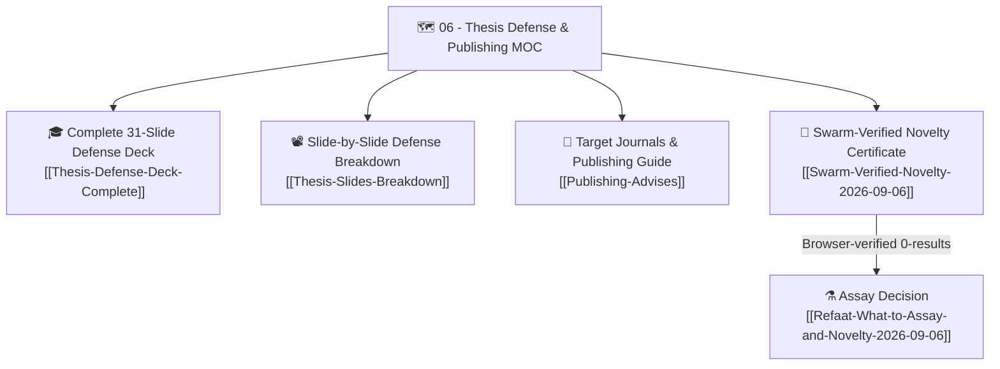

# 🗺️ Map of Content (MOC): 06 — Thesis Defense & Publishing Strategy

> **Thematic Hub:** Academic defense preparations, slide-by-slide examination strategies, committee viva question scripts, and Q1/Q2 peer-reviewed journal targeting for Dr. Refaat Ibrahim.

---

## 📌 Core Navigational Structure

---

## 📑 Detailed Note Index & Scientific Roles

1. **[[Thesis-Defense-Deck-Complete|Complete 31-Slide Thesis Defense Presentation & Committee Examination Guide]]**  
   *Scope:* The complete verbatim transcription and defense strategy for Dr. Refaat's presentation (`Thesis.pptx`), structured into 6 academic sections:
   - Section 1: Title & Epidemiological Foundation (Slides 1–4)
   - Section 2: Clinical Dilemma of Glucocorticoid Therapy (Slides 5–10)
   - Section 3: PEA as an Autacoid Sparing Agent (Slides 11–13)
   - Section 4: Molecular Mechanism: PPAR-α & Novel NF-κB Modulation (Slides 14–18)
   - Section 5: PPAR-α and Glucocorticoid Receptor Cross-Talk (Slides 19–22)
   - Section 6: Official Experimental Design, Pilot Validation & Hypotheses (Slides 23–31)
2. **[[Thesis-Slides-Breakdown|Thesis Presentation Slide-by-Slide Defense Breakdown]]**  
   *Scope:* Focused speaker notes, timing allocations, anticipated committee interrogation questions, and bulletproof counter-arguments.
3. **[[Publishing-Advises|Target Journals (Q1/Q2) & Academic Publication Guidance]]**  
   *Scope:* Detailed strategic roadmap from Dr. Refaat's records (`advises on publishing.rtf`), analyzing high-impact international pharmacology journals:
   - *Biomedicine & Pharmacotherapy* (Elsevier, Q1)
   - *Inflammopharmacology* (Springer, Q1)
   - *European Journal of Pharmacology* (Elsevier, Q2/Q1)
   - *International Immunopharmacology* (Elsevier, Q1)
   Includes publication requirements, data presentation norms, and reviewer response strategies.

---

## 🔗 Bidirectional Second Brain Connections
- [[C2-novelty-gap-search-2026-10-06|🆕 Novelty gap search 2026-10-06 — 30+ sources, 0 claims broken, claim 2 (GC-sparing) weakened]] · base search: [[C-novelty]]
- [[Swarm-Verified-Novelty-2026-09-06|🆕 Swarm-Verified Novelty Certificate — PubMed Browser Search Evidence (2026-09-06)]]
- [[Novelty-and-Affordable-Biomarker-Decision-2026-09-06|2026-09-06 source-checked novelty and affordable assay decision: conditional shortlist and evidence corrections]]
- [[Refaat-What-to-Assay-and-Novelty-2026-09-06|⚠️ القرار الموحَّد (Reconciled) — Tier A/B مشروط بتأكيد البروتوكول الرسمي، بعد 3 توصيات متضاربة في نفس اليوم]]
- [[Codex-Antigravity-Consensus-Lean-Budget-Verdict|💰 توصية Tier A الأرخص (Antigravity + Codex مستقل) — تحذف NF-κB IHC وELISA بالكامل، غير مُحسومة بعد]]
- [[Codex-Adversarial-Review-and-Critique-2026-09-06|🛡️ تقرير المراجعة النقدية المستقلة وتحكيم خطة النشر الدولي — OpenAI Codex (GPT-6)]]
- [[Pharmacology-Professor-Critical-Assessment-2026-09-06|🎓 تقييم نقدي مستقل: هل المسار بعد البايلوت صالح للنشر الدولي؟]]
- Previous Domain Hub: [[05-MOC-Comparators-Benchmarking]]
- Next Domain Hub: [[07-MOC-Automated-QC-and-Audits]]
- Protocol Evidence: [[Official-Institutional-Protocol-Final]]
- Molecular Axis Evidence: [[Bougarne-2018-PPARa-GR-Molecular-Interplay]]
