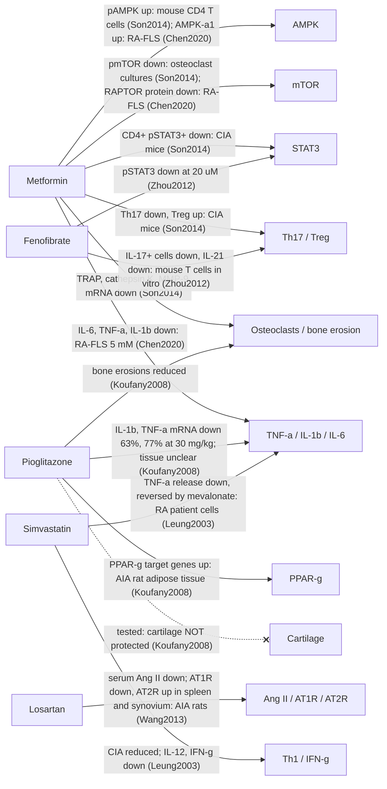

# 4.4 Emerging candidates

> ازاي تستخدم الملف ده:
> 1. اقرا الفكرة بالعربي.
> 2. اكتب الجملة بالإنجليزي بأسلوبك في ملف اليوم، باستخدام الكلمات اللي في الصندوق.
> 3. لو عايز تتأكد، اضغط اللينك، هيوديك على الجملة المتعلّمة في البحث بالظبط.

## Propranolol

### جملة 1
في فئران عندها التهاب مفاصل تجريبي، البروبرانولول قلّل الالتهاب في القلب وقلّل اضطراب ضربات القلب.
```
propranolol (non-selective beta-blocker)
collagen-induced arthritis (CIA) rats
anti-inflammatory and antiarrhythmic
[Lin2020]
```
🔗 [[papers/Lin2020#^lin2020-2|شوف الجملة في البحث]]

**✍️ جملتك:**
```

```

### جملة 2
بس التهاب المفاصل نفسه كان تقريبًا زي الفئران اللي ماخدتش علاج، واتحسّن شوية بس في آخر التجربة.
```
joint inflammation similar to untreated CIA rats
only mildly relieved late in the disease course
[Lin2020]
```
🔗 [[papers/Lin2020#^lin2020-3|شوف الجملة في البحث]]

**✍️ جملتك:**
```

```

### جملة 3
وفي المرضى، تحليل متأخر لبيانات تجارب قديمة لقى إن اللي كانوا بياخدوا حاصرات بيتا وصلوا للهدوء التام أقل.
```
post hoc analysis of pooled trial data
5502 patients, 594 (10.8%) on beta-blockers
associated with less frequent SDAI remission
adjusted HR 0.70 (95% CI 0.57–0.87)
[Abuhelwa2021]
```
🔗 [[papers/Abuhelwa2021#^abuhelwa2021-2|شوف الجملة في البحث]]
🔗 [[papers/Abuhelwa2021#^abuhelwa2021-3|شوف الجملة في البحث]]

**✍️ جملتك:**
```

```

## Sertraline

### جملة 4
في فئران التهاب المفاصل، السيرترالين ماقلّلش التهاب الغشاء ولا تآكل الغضروف والعظم، في حين إن الميثوتريكسات والأدوية البيولوجية حسّنوهم.
```
sertraline (SSRI), CIA rats
did not reduce synovial inflammation, cartilage damage or bone erosion
methotrexate and biologics improved structural damage
[Chmielewski2026]
```
🔗 [[papers/Chmielewski2026#^chmielewski2026-1|شوف الجملة في البحث]]
🔗 [[papers/Chmielewski2026#^chmielewski2026-2|شوف الجملة في البحث]]

**✍️ جملتك:**
```

```

## DPP-4 inhibitors

### جملة 5
في دراسة على مرضى السكر، أدوية السيتاجليبتين وأخواتها ماكانتش مرتبطة بخطر ظهور الروماتويد.
```
DPP-4 inhibitors (e.g. sitagliptin)
nested case-control study in diabetic patients
790 RA cases, 11,850 controls
adjusted OR 1.16 (95% CI 0.94–1.43), not significant
[Kathe2018]
```
🔗 [[papers/Kathe2018#^kathe2018-2|شوف الجملة في البحث]]
🔗 [[papers/Kathe2018#^kathe2018-3|شوف الجملة في البحث]]

**✍️ جملتك:**
```

```

### جملة 6
بس في المرضى اللي مش بياخدوا إنسولين، الخطر كان أعلى شوية وبفرق حقيقي.
```
non-insulin subgroup: significant positive association
OR 1.30 (95% CI 1.001–1.985)
[Kathe2018]
```
🔗 [[papers/Kathe2018#^kathe2018-4|شوف الجملة في البحث]]

**✍️ جملتك:**
```

```

## Amitriptyline

### جملة 7
الأميتريبتيلين اتقال إنه بيثبّط إنزيم معيّن؛ الفئران اللي اتشال منها الإنزيم ده جالها التهاب مفاصل أقل، بس الدوا نفسه محدش جرّبه في التهاب المفاصل.
```
amitriptyline: proposed SphK1 inhibitor (drug untested in arthritis)
SphK1 knockout mice: reduced synovitis and joint pathology
[Bu2021]
```
🔗 [[papers/Bu2021#^bu2021-2|شوف الجملة في البحث]]

**✍️ جملتك:**
```

```

## Valproate

### جملة 8
أدوية من نفس عيلة الفالبروات قلّلت درجة التهاب المفاصل في الفئران، بس الفالبروات نفسه ماتجرّبش.
```
valproate: HDAC inhibitor (class effect only)
selective HDAC6 inhibitors (CKD-L, tubastatin A)
decreased arthritis score in CIA mice
[Oh2017]
```
🔗 [[papers/Oh2017#^oh2017-2|شوف الجملة في البحث]]

**✍️ جملتك:**
```

```

### جملة الخلاصة
الأدوية دي، ومعاها الألوبيورينول، لسه فكرة أو دليلها متضارب، ومحتاجة تجارب على الحيوانات مصمّمة كويس قبل أي تجربة على المرضى.
```
allopurinol: no RA-specific data
hypothesis-generating or conflicting evidence (Table 2)
well-designed preclinical studies needed before clinical trials
```
(الجملة دي مالهاش مرجع، دي رأيك إنت)

---

**✍️ جملتك:**
```

```

## Table 2 rows (Claude هيجمعها)
| Drug (original use) | Proposed target | Best evidence | Direction | Tag |
|---|---|---|---|---|
| Propranolol (antihypertensive) | β-adrenergic / neuro-immune | CIA rats; pooled RCT data | ⚪ conflicting | Lin2020, Abuhelwa2021 |
| Sertraline (antidepressant) | 5-HT / neuroimmune | CIA rats | ❌ no structural benefit | Chmielewski2026 |
| Sitagliptin (antidiabetic) | DPP-4 / CXCL12 | case-control | ⚪ neutral | Kathe2018 |
| Valproate (antiepileptic) | HDAC | class effect (HDAC6i in CIA) | hypothesis | Oh2017 |
| Allopurinol (antigout) | Xanthine oxidase | none RA-specific | hypothesis | — |

## ⚠️ ملاحظات
- جرعة البروبرانولول مكتوبة في ملخص البحث بشكل وفي طرق العمل بشكل تاني، فماتكتبش الجرعة خالص.
- في بحث حاصرات بيتا، تقريبًا ٩ من كل ١٠ مرضى كانوا على النوع الانتقائي للقلب، مش زي البروبرانولول؛ فالنتيجة مش عن البروبرانولول بالظبط. واكتب "مرتبط"، مش "سبّب".
- الأبحاث هنا مابتذكرش الأميتريبتيلين ولا الفالبروات نفسهم: الأول للإنزيم بس، والتاني لعيلة الأدوية بس. قول "اتقال" أو "مقترح"، ماتقولش "اتثبت". ولو عايز تقول إن الأميتريبتيلين بيثبّط الإنزيم ده، محتاج مرجع لوحده.
- الألوبيورينول مالوش مرجع، وده عادي في جملة الخلاصة.

---

# تعديلات خطوة 11

> اللي فوق ده الموجز القديم، سيبه زي ما هو. التعديلات الجديدة كلها هنا تحت:
> 1. مسودة الشكل التاني.
> 2. قسم جديد لمثبطات الإنزيم الهاضم للببتيد جوه أدوية السكر.
> 3. جملة واحدة مكان القسم ده كله، وجدول 2 بعد التصحيح.

## 1. مسودة الشكل التاني (الأدوية على المسارات المشتركة)

الخط المتصل = نتيجة في البحث نفسه (الملخص أو النتايج أو شرح الصورة).
الخط المتقطع = كلام في المناقشة، أو نتيجة مش دالة، أو علاقة ارتباط بس.
كل سهم عليه اسم البحث، والمصدر الحرفي في ملف الكروت.


- 🔁 **تعديلات خطوة 12 على الشكل (11/10):** الخط المتقطع اتلغى. السهم المتصل معناه نتيجة في البحث، والخط المنقّط اللي آخره علامة ✕ معناه إن الحاجة اتجرّبت ومالهاش تأثير.
  - البيوجليتازون والغضروف: مقياس الهدم في البول اتشال من على السهم ده، لأنه مقياس لهدم العظم، ونتيجته ماكانتش دالة.
  - اللوسارتان: السهمين بقوا سهم واحد متصل، لأن تغيّر المستقبلات اتقاس فعلًا بعد العلاج. الارتباط مع درجة الالتهاب يتقال في النص بس.
  - الفينوفايبرات: السهم بتاع مستقبله اتشال، وبقى ملاحظة تحت الشكل، لأن الباحثين بيقولوا إن التأثير "يمكن" مايكونش عن طريقه.
  - السيمفاستاتين: راس السهم بقت على مربع السيتوكينات، والكارت بتاعه اتوسّع (27 من 27 مطابقين).
  - برنامج الرسم اتحفظ عشان أي تعديل بعد كده:
```
scripts/fig2_draft.py
```

### ⚠️ ملاحظات على الشكل
- الميتفورمين والإنزيم المسؤول عن النمو: النتيجة في خلايا هدم العظم وفي خلايا الغشاء (بروتين مرتبط بيه قلّ)، بس مش في الخلايا التائية. فماترسمش سهم منه للخلايا التائية.
- بحث الميتفورمين على خلايا الغشاء: الجرعة مكتوبة بأكتر من شكل في البحث. اكتب الجرعة من جزء الطرق بس. والباحثين نفسهم قالوا في المناقشة إن الدوا غالبًا مش هينفع كعلاج للروماتويد، فده يتقال في النص. والتركيز ده (5 مللي مولار) أعلى بكتير من اللي بيوصل للدم في العلاج، والباحثين نفسهم قالوا كده.
```
Chen2020
```
- بحث البيوجليتازون: الكلام بيقول نسيج دهني، وعنوان الجدول بيقول الغشاء المبطّن للمفصل. السهم مكتوب من غير اسم النسيج لحد ما تختار.
```
Koufany2008
```
- بحث اللوسارتان: الجرعات مختلفة في أماكن في البحث، فماتكتبش جرعة على الشكل.
```
Wang2013
```
- بحث السيمفاستاتين: الباحثين قالوا إن الجرعة في الفيران أعلى من اللي بيستخدمها الإنسان، فده يتقال في النص.
```
Leung2003
```
- مثبطات الإنزيم الهاضم للببتيد مش في الكروت دي. لو عايزها على الشكل، فيه نتيجة من البحث المصري إن السيتاجليبتين قلّل بروتين الإشارة في الغشاء، بس أقل من التوفاسيتينيب (الرابط في جملة 7 تحت).

## 2. قسم جديد 4.1.5: مثبطات الإنزيم الهاضم للببتيد

> مكانه: في اليوم التالت، بعد قسم مثبطات نقل الصوديوم.
> الجمل 5 و6 القديمة اللي فوق بتتنقل هنا (جملة 5 تحت)، فماتكتبهمش في القسم الناشئ.

### جملة 1
الأدوية دي ظهرت في أغلب دراسات مرضى السكر (ومنهم مرضى روماتويد) كمجموعة مقارنة، مش كعلاج بيتدرس لوحده.
```
DPP-4 inhibitors mostly used as active comparator in T2D cohorts (with RA, or RA as outcome)
GLP-1 RA vs DPP-4i: 8,697 matched pairs [WangQ2025]
SGLT2i (n = 823) vs DPP-4i (n = 284) before matching; 277 matched pairs [Kachhadia2026]
T2D cohort, RA as outcome: SGLT2i vs DPP-4i: 206,069 matched pairs; RA risk HR 0.914 (0.831–1.005) [Yen2026]
GLP-1 RA vs DPP-4i: 4,607 per group [Yu2026]
non-GLP-1RA comparator group incl. DPP-4i, SGLT2i, SU, TZD [Malik2026]
```
🔗 [[papers/WangQ2025#^wangq2025-1|شوف الجملة في البحث]]
🔗 [[papers/Kachhadia2026#^kachhadia2026-5|شوف الجملة في البحث]]
🔗 [[papers/Kachhadia2026#^kachhadia2026-1|شوف الجملة في البحث]]
🔗 [[papers/Yen2026#^yen2026-1|شوف الجملة في البحث]]
🔗 [[papers/Yen2026#^yen2026-5|شوف الجملة في البحث]]
🔗 [[papers/Yu2026#^yu2026-1|شوف الجملة في البحث]]
🔗 [[papers/Malik2026#^malik2026-3|شوف الجملة في البحث]]
⚠️ الأبحاث الخمسة دي في جملة واحدة مجمّعة، بالأعداد بس. نتايجها الأساسية مكتوبة في أقسامها في اليوم التالت، فماتكررهاش.

**✍️ جملتك:**
```

```

### جملة 2
في أحدث دراسة، المرضى على أدوية الجلوكاجون كان موتهم أقل من المرضى على مثبطات الإنزيم، بس أزمات القلب ماكانش فيها فرق.
```
RA + T2D, TriNetX, active-comparator new-user design
all-cause mortality HR 0.68 (95% CI 0.58–0.80), GLP-1 RA vs DPP-4i
MACE HR 0.96 (95% CI 0.89–1.04), no difference
[Yu2026]
```
🔗 [[papers/Yu2026#^yu2026-2|شوف الجملة في البحث]]
🔗 [[papers/Yu2026#^yu2026-3|شوف الجملة في البحث]]
⚠️ دي نتيجة عن أدوية الجلوكاجون مقارنة بالمثبطات، مش عن المثبطات نفسها. ودي دراسة مراقبة، والباحثين قالوا إنها بتورّي ارتباط مش سببية. اكتب "مرتبط"، مش "سبّب".
⚠️ في مناقشة البحث، رقم الالتهاب الرئوي (11%) مش متطابق مع الرقم في النتايج (13%). ماتكتبش رقم الالتهاب الرئوي.

**✍️ جملتك:**
```

```

### جملة 3
في مرضى السكر، اللي بدأوا مثبطات الإنزيم كان خطر ظهور الروماتويد عندهم أقل من اللي بدأوا تركيبة تانية مع الميتفورمين.
```
population-based cohort, T2D initiators
DPP-4i vs non-DPP-4i combination (metformin + another drug)
incident RA: PS-stratified HR 0.66 (95% CI 0.44–0.99)
[Kim2015]
```
🔗 [[papers/Kim2015#^kim2015-1|شوف الجملة في البحث]]
🔗 [[papers/Kim2015#^kim2015-2|شوف الجملة في البحث]]
⚠️ الحد الأعلى للثقة 0.99، يعني النتيجة على الحافة. قول "أقل بشكل بسيط".
⚠️ في التحليل التاني (المجموعات المتطابقة)، النتايج كانت قريبة بس حدود الثقة واسعة لأن العدد أقل. فاكتب إن النتيجة دي من التحليل الأساسي.

**✍️ جملتك:**
```

```

### جملة 4
بس لما اتقارنت بأدوية سكر معيّنة (البيوجليتازون وأدوية السلفونيل يوريا) الخطر ماقلّش بفرق دال (حتى لو الرقم أقل من واحد)، والباحثين نفسهم قالوا إن فيه عوامل ممكن تكون أثّرت.
```
vs TZD: HR 1.04 (0.51–2.12); vs sulfonylureas: HR 0.66 (0.38–1.15)
residual confounding (indication, obesity, smoking, SES) acknowledged
[Kim2015]
```
🔗 [[papers/Kim2015#^kim2015-3|شوف الجملة في البحث]]
🔗 [[papers/Kim2015#^kim2015-4|شوف الجملة في البحث]]

**✍️ جملتك:**
```

```

### جملة 5
دراسة تانية على مرضى السكر لقت إن العلاقة بين الأدوية دي وظهور الروماتويد مش دالة، ماعدا مجموعة اللي مش بياخدوا إنسولين.
```
nested case-control, diabetic patients: 790 RA cases, 11,850 controls
DPP-4i not significantly associated with RA: adjusted OR 1.156 (0.936–1.429)
non-insulin subgroup: OR 1.299 (1.001–1.985), positive association
[Kathe2018]
```
🔗 [[papers/Kathe2018#^kathe2018-2|شوف الجملة في البحث]]
🔗 [[papers/Kathe2018#^kathe2018-3|شوف الجملة في البحث]]
🔗 [[papers/Kathe2018#^kathe2018-4|شوف الجملة في البحث]]
⚠️ دي الجملتين 5 و6 القديمتين مدموجين. رقم المجموعة الفرعية مش في نص المسافة بين حدود الثقة، والحد الأدنى 1.001 بالعافية فوق الواحد، فاذكره كإشارة بس.
⚠️ الدراسة دي واللي قبلها نتيجتهم مختلفة، فاكتبهم جنب بعض كدليل متضارب.

**✍️ جملتك:**
```

```

### جملة 6
في بحث مصري على جرذان عندها التهاب مفاصل تجريبي (بمادة محفّزة، مش روماتويد حقيقي)، السيتاجليبتين قلّل تورّم الرجل وقلّل علامات الالتهاب في الدم.
```
Egyptian study (Alexandria), adjuvant-induced arthritis rats
sitagliptin 100 mg/kg/day orally
less hind-paw swelling vs untreated
lower anti-CCP, RANKL, TNF-α, IL-6 (P < 0.001)
[Ibrahim2020]
```
🔗 [[papers/Ibrahim2020#^ibrahim2020-1|شوف الجملة في البحث]]
🔗 [[papers/Ibrahim2020#^ibrahim2020-2|شوف الجملة في البحث]]
🔗 [[papers/Ibrahim2020#^ibrahim2020-3|شوف الجملة في البحث]]
🔗 [[papers/Ibrahim2020#^ibrahim2020-5|شوف الجملة في البحث]]
⚠️ ماتحوّلش الجرعة لجرعة الإنسان (اتقرر 11/10).

**✍️ جملتك:**
```

```

### جملة 7
بس تأثيره على درجة تورّم المفاصل (درجة من 0 لـ 16 بالفحص، مش أشعة) وعلى بروتين الإشارة في الغشاء كان أقل من التوفاسيتينيب.
```
smaller arthrogram score reduction than tofacitinib
p-STAT3 in synovium reduced less than tofacitinib
[Ibrahim2020]
```
🔗 [[papers/Ibrahim2020#^ibrahim2020-4|شوف الجملة في البحث]]
🔗 [[papers/Ibrahim2020#^ibrahim2020-6|شوف الجملة في البحث]]

**✍️ جملتك:**
```

```

### جملة 8
وفيه رأي معاكس: بحث لقى إن الإنزيم نفسه أقل في غشاء مفصل مرضى الروماتويد، وإن مثبطاته زوّدت مواد الالتهاب في خلايا الغشاء.
```
DPP4 lower in RA synovial tissue vs normal
sitagliptin and vildagliptin increased proinflammatory cytokines (RA synovial fibroblasts)
[Han2021]
```
🔗 [[papers/Han2021#^han2021-1|شوف الجملة في البحث]]
🔗 [[papers/Han2021#^han2021-2|شوف الجملة في البحث]]
⚠️ عندنا الملخص بس، فماتكتبش أرقام. والنتيجة دي في المعمل، مش في المرضى.
⚠️ الباحثين استنتجوا إن ده يزوّد خطر الروماتويد، وده استنتاج من تجارب معمل بس. ماتنقلوش كأنه نتيجة.

**✍️ جملتك:**
```

```

### جملة الخلاصة
الدليل لحد دلوقتي من دراسات مراقبة متضاربة وتجارب على الحيوانات والخلايا في المعمل، ومالقيناش تجربة عشوائية على مرضى الروماتويد في السجلات اللي اتقرت.
```
evidence limited to conflicting observational data, animal and in vitro studies
no randomised trial of DPP-4 inhibitors in RA identified in the registries searched
```
(الجملة دي مالهاش مرجع، دي رأيك إنت)
⚠️ البحث عن التجارب: سجل التجارب الأمريكي 0، وقاعدة الأبحاث الأوروبية 23 نتيجة اتقروا كلهم ومفيش تجربة. سجل منظمة الصحة العالمية ماتقريش (الموقع ماشتغلش). فاكتب "مالقيناش"، ماتكتبش "مفيش خالص".

**✍️ جملتك:**
```

```

### ⚠️ قرارات مستنية رأيك (القسم ده)
- ✅ قرار (11/10): السنين تفضل زي أسامي الملفات، 2015 للكوري و2018 للأمريكي (سنة العدد في المجلة).
- ✅ قرار (11/10): جملة تعريف الأدوية دي اتشالت، ماتكتبهاش.
- ✅ قرار (11/10): مفيش جملة تحويل جرعة للإنسان، لأن ملف النشرة مش موجود.
- ✅ قرار (11/10): الشكل التاني يفضل زي ما هو، ويتراجع تاني في الخطوة 12.

## 3. جملة واحدة مكان القسم الناشئ كله

> كل الجمل من 1 لـ 8 القديمة وجملة الخلاصة القديمة (فوق) بتتشال من المسودة، وبيتحط مكانهم الجملة دي بس.

### جملة الإشارة
فيه أدوية تانية اتقال إنها ممكن تنفع، بس دليلها لسه فكرة أو متضارب، ومجمّعة في جدول 2.
```
other proposed candidates (propranolol, sertraline, valproate)
hypothesis-generating or conflicting evidence
summarised in Table 2
```
(الجملة دي مالهاش مرجع، المراجع في الجدول)

**✍️ جملتك:**
```

```

## جدول 2 بعد التصحيح
| Drug (original use) | Proposed target | Best evidence | Direction | Tag |
|---|---|---|---|---|
| Propranolol (antihypertensive) | β-adrenergic / neuro-immune | CIA rats: joint effect late and mild; humans: beta-blocker use (89% β1-selective, not propranolol) linked to less remission, HR 0.70 (0.57–0.87), post hoc | ❌ not supportive | Lin2020, Abuhelwa2021 |
| Sertraline (antidepressant) | 5-HT / neuro-immune | CIA rats | ❌ no structural benefit | Chmielewski2026 |
| Valproate (antiepileptic) | HDAC | selective HDAC6 inhibitors (CKD-L, tubastatin A) in CIA mice; valproate not named | hypothesis | Oh2017 (class only) |

### ⚠️ التصحيحات في الجدول
- صف السيتاجليبتين اتشال، لأنه راح للقسم الجديد في أدوية السكر.
- بحث الفالبروات مابيذكرش الفالبروات خالص. المكتوب في الجدول هو اللي فيه فعلًا: عيلة الأدوية بس.
- بحث البروبرانولول على الفئران: الملخص بيقول إن تورّم الرجل قلّ، والنتايج بتقول إن المفاصل كانت زي الفئران اللي ماتعالجتش وإتحسنت شوية بس في الآخر. الجدول ماشي على النتايج.
- بحث حاصرات بيتا: 89% كانوا على النوع الانتقائي للقلب، فده مكتوب في الجدول. والنتيجة في المرضى ضد الفايدة، فالاتجاه اتغير لـ "مش داعم".
- ✅ قرار (11/10): صف الأميتريبتيلين اتشال (مصدره مراجعة مش بحث أصلي، ومابيذكرش الدوا)، وصف الألوبيورينول اتشال (مالوش مصدر). ماحدش فيهم يتذكر في المسودة.
