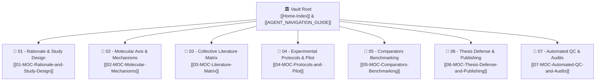

# 🤖 Universal AI Agent & LLM Navigation Guide
## Port Said University Master's Thesis Research Vault
### Department of Pharmacology & Toxicology | Faculty of Pharmacy

> **Welcome, AI Colleague!**  
> This master navigation document is designed to give **ANY language model or autonomous agent** (Claude, GPT, Gemini, DeepSeek, Llama, Cursor, etc.) immediate, 100% accurate contextual awareness of this research vault.  
> Read this document first to understand the scientific hypotheses, directory structure, dosing regimens, and operating rules without having to parse dozens of files.  
> 
> 📄 **Companion Machine-Readable Manifest:** A structured JSON schema equivalent is available at `AGENT_NAVIGATION_GUIDE.json` for automated LLM context injection, system prompts, or API ingestion.

---

## 1. Executive Research Context & Academic Identity

- **Researcher / Master's Candidate:** **Dr. Refaat Ibrahim (Teaching Assistant Riffat Ibrahim Riffat)**
- **Academic Department:** Department of Pharmacology & Toxicology, Faculty of Pharmacy, Port Said University (Egypt).
- **Supervisory Committee:**
  1. **Assoc. Prof. Ahmed Aboul-Fotouh Elsayed Mourad** (*Head of Department, Associate Professor of Pharmacology & Toxicology*)
  2. **Assoc. Prof. Ahmed Gaafar Ahmed** (*Associate Professor of Pharmacology & Toxicology*)
  3. **Assoc. Prof. Ahmed Saad Saad** (*Associate Professor of Pharmacology & Toxicology*)
- **Official Thesis Title:**  
  *Targeting Experimentally Induced Arthritis in Rats Using Selected Natural Products as Glucocorticoid-Sparing Agents*  
  *(Alternative presentation title: Evaluating Micronized Palmitoylethanolamide [m-PEA] as a Glucocorticoid-Sparing Strategy in Adjuvant-Induced Arthritis in Wistar Rats)*
- **Operational & Budgetary Ground Reality (MANDATORY AGENT MANDATE):**
  - **100% Self-Funded Out-of-Pocket:** Zero university or departmental funding. Every rat, kit, and slide is paid for from Dr. Refaat's personal salary/savings.
  - **Port Said University Facility Reality:** Under-equipped local facilities (NO liquid nitrogen at sacrifice, NO -80°C cold-chain transport, NO automated ELISA/molecular platforms).
  - **Mandatory Assay Outsourcing:** All specialized analyses (ELISA, IHC, histopathology, clinical chemistry) must be outsourced to external referral labs in Cairo/Tanta.
  - **Agent Decision Rule:** Forbid high-cost/fragile exploratory molecular panels (RT-qPCR, Phospho-p38 Western blots). Prioritize durable FFPE paraffin blocks (H&E, Safranin-O, NF-κB p65 IHC) and stable frozen serum with affordable local Egyptian kits (e.g., Biodiagnostic).

---

## 2. Core Pharmacological & Biological Hypotheses

### A. The Clinical Bottleneck
Rheumatoid Arthritis (RA) is an autoimmune polyarthritis characterized by synovial hyperplasia (pannus), cartilage proteoglycan erosion, and subchondral osteoclastogenesis driven by **NF-κB** and **p38 MAPK** hyperactivation. While glucocorticoids (e.g., Prednisolone) provide unmatched acute relief, chronic administration causes debilitating dose-limiting toxicities:
- Secondary osteoporosis and pathological fractures.
- Steroid-induced insulin resistance, hyperglycemia, and diabetes.
- Hypothalamic-Pituitary-Adrenal (HPA) axis suppression.

### B. The Glucocorticoid-Sparing Solution
**Palmitoylethanolamide (PEA)** is an endogenous lipid autacoid (an $N$-acylethanolamine) that acts as an **ALIAmide** (Autacoid Local Inflammation Antagonist). By co-administering PEA alongside a **sub-therapeutic, halved dose of Prednisolone (5 mg/kg)**:
1. **The "Dual-Clamp" Molecular Synergy:**
   - **PEA (Cytosolic Clamp):** Directly activates **PPAR-α**, recruiting **DRIP205/MED1** and **Sp1** coactivators to transactivate the promoter of the *NFKBIA* gene (encoding **IκBα**). Newly synthesized IκBα traps the p65/p50 heterodimer in the cytoplasm.
   - **Prednisolone (Nuclear Clamp):** Binds **GR-α**, translocates to the nucleus, tethers residual nuclear p65, and recruits **HDAC2** corepressors to epigenetically silence the promoters of *TNF*, *IL1B*, and *IL6*.
2. **Complete Toxicity Avoidance:** Halving the steroid load eliminates hyperglycemia, preserves trabecular bone mineral density, and prevents HPA-axis shutdown.

---

## 3. Topographical Vault Map: The 7 Maps of Content (MOCs)

The vault is organized into **7 thematic functional directories**, each anchored by a dedicated Map of Content (MOC) note:

### Quick Directory Reference Table:

| Folder Path | Domain Hub (MOC) | Primary Contents & Focus | Key Starting Note |
|:---|:---|:---|:---|
| `01 - Rationale & Study Design/` | [[01-MOC-Rationale-and-Study-Design]] | Animal model justifications, Prednisolone active moiety rationale, CFA parameters. | [[Prednisolone-Active-Moiety-Rationale]] |
| `02 - Molecular Axis & Mechanisms/`| [[02-MOC-Molecular-Mechanisms]] | PPAR-α/GR cross-talk, Bougarne 2018 review, Wang 2025 clinical review, NF-κB, p38 MAPK. | [[PPARa-and-GR-Crosstalk-Axis]] |
| `03 - Collective Literature Matrix/`| [[03-MOC-Literature-Matrix]] | 12 literature studies, 2 nanoparticle precedents, 29 paper extracts, Master Design Table. | [[Master-Study-Design-Table]] |
| `04 - Experimental Protocols & Pilot/`| [[04-MOC-Protocols-and-Pilot]] | Official 6-page PSU protocol (9 groups), tablet prep SOP, quarantined pilot data ($n=2$). | [[Official-Institutional-Protocol-Final]] |
| `05 - Comparators Benchmarking/` | [[05-MOC-Comparators-Benchmarking]] | Active preclinical comparators: Baricitinib (JAK1/2) and Tacrolimus (Calcineurin). | [[Baricitinib-Comparison]] |
| `06 - Thesis Defense & Publishing/` | [[06-MOC-Thesis-Defense-and-Publishing]] | Complete 31-slide defense presentation deck, viva questions, Q1/Q2 journal strategy. | [[Thesis-Defense-Deck-Complete]] |
| `07 - Automated QC & Audits/` | [[07-MOC-Automated-QC-and-Audits]] | Swarm topology, 314-skill manifest digest, 10-gate logical QC, 23-gap resolution report. | [[logical_qc_report]] |

---

## 4. Key Experimental Parameters & Dose Cheatsheet

If the user asks about experimental specifics, use these verified constants:

- **Animal Model:** Adult female Wistar rats (*Rattus norvegicus*), weighing **160–200 g**.
- **Induction Technique:** Single subcutaneous (s.c.) injection of **0.3 mL Complete Freund's Adjuvant (CFA)** (containing $1\text{ mg/mL}$ heat-killed *Mycobacterium tuberculosis* H37Ra) into the right inguinal / proximal thigh region on **Day 0**.
- **Negative Control Induction:** Single s.c. injection of **0.25 mL sterile paraffin oil** into the same anatomical site.
- **Experimental Timeline:**
  * **Days 0–15:** Induction & systemic sensitization phase (development of bilateral polyarthritis).
  * **Days 16–45:** Therapeutic phase (daily oral gavage treatment for **30 consecutive days**).
  * **Day 46:** Terminal euthanasia, blood harvesting via cardiac puncture, and joint tissue excision.

### The Official 9-Group Architecture:
1. **Group 1:** Negative Control (Paraffin oil s.c. + 0.5% CMC-Na vehicle p.o.)
2. **Group 2:** Positive Arthritic Control (CFA 0.3 mL s.c. + 0.5% CMC-Na vehicle p.o.)
3. **Group 3:** Prednisolone Monotherapy (Full standard dose: **10 mg/kg/day p.o.**)
4. **Group 4:** m-PEA Monotherapy (Full autacoid dose: **200 mg/kg/day p.o.**)
5. **Group 5:** Low-Dose Combination (**m-PEA 50 mg/kg + Prednisolone 5 mg/kg p.o.**)
6. **Group 6:** Mid-Dose Combination (**m-PEA 100 mg/kg + Prednisolone 5 mg/kg p.o.**)
7. **Group 7:** High-Dose Combination (**m-PEA 200 mg/kg + Prednisolone 5 mg/kg p.o.**)
8. **Group 8:** Tacrolimus Reference (Calcineurin inhibitor: **1.8 mg/kg/day p.o.**)
9. **Group 9:** Baricitinib Reference (Targeted JAK1/JAK2 inhibitor: **10 mg/kg/day p.o.**)

- **Drug Source for PEA:** Egyptian commercial **Limitless PEA** tablets finely pulverized into a uniform micronized suspension using an analytical mortar and pestle ([[PEA-Tablet-Preparation]]).

---

## 5. Non-Negotiable AI Operating Rules

Whenever you assist the user in this repository, strictly adhere to these 4 foundational laws:

### 🔒 Law 1: Absolute Quarantine of Pilot Study Data ($n=2$)
- The pilot screening study was conducted with only **$n=2$ rats per group** (`00-Sources/pilot/`, `pilot.docx`, `Blood work final.pdf`, `WBC final.pdf`).
- **RULE:** Pilot data provides proof-of-feasibility only. **NEVER** present pilot numbers as confirmatory thesis results, and **NEVER** pool them into literature meta-analyses. Always label pilot references with explicit `[!WARNING]` quarantine notices.

### 📜 Law 2: Ground Truth Precedence (`00-Sources/`)
- If any discrepancy arises between a note and the original laboratory records in `00-Sources/`, **the original source file is the ultimate source of truth**.

### 🔗 Law 3: Zettelkasten Bidirectional Link Integrity
- Always format cross-references using standard Obsidian wikilinks (e.g., [[Official-Institutional-Protocol-Final]]).
- Ensure no broken links are created. All notes must be discoverable through the 7 MOCs or [[Home-Index]].

### 🔬 Law 4: Zero Academic Hallucination
- Never invent DOIs, authors, or experimental findings. Every scientific claim must map directly to the 29 canonical paper notes in `03 - Collective Literature Matrix/Papers/` or the source monographs in `02 - Molecular Axis & Mechanisms/`.

---

## 6. Programmatic Verification & Audit Toolkit

The vault includes autonomous Python verification scripts in the `scripts/` directory that can be executed at any time to certify vault integrity:

| Command | Script Path | What It Verifies |
|:---|:---|:---|
| `python scripts/run_logical_qc.py` | `scripts/run_logical_qc.py` | **10-Gate Deep Logical QC:** Pharmacological coherence, steroid-sparing logic, CFA induction params, cohort symmetry, pilot quarantine, comparator DMARDs, molecular signaling, and Zettelkasten graph integrity. |
| `python scripts/gap_audit.py` | `scripts/gap_audit.py` | **Dynamic Gap Audit:** Verifies that all 23 historical issues remain 100% resolved (0 issues found). |
| `python scripts/run_qc_audit.py` | `scripts/run_qc_audit.py` | **4-Gate Master QC:** Multi-format data parity across Excel, Word, and PDF files. |
| `cmd.exe /c ruflo swarm status` | Ruflo CLI | **Live Swarm Status:** Checks the active 21-agent Ruflo V3 mesh coordination. |

---

## 7. Interactive Visual Artifacts

For visual exploration in Obsidian:
- 🗺️ **Swarm & Vault Architecture Canvas:** `07 - Automated QC & Audits/Swarm-and-Vault-Architecture.canvas`
- 🧬 **Molecular Signaling Pathways Canvas:** `02 - Molecular Axis & Mechanisms/Mechanistic-Pathways.canvas`
- 📊 **Literature Matrix Database View:** `03 - Collective Literature Matrix/Studies-Comparison.base`
- 📑 **Research Papers Database View:** `03 - Collective Literature Matrix/Research-Papers.base`
- 🐝 **Skills Manifest Database View:** `07 - Automated QC & Audits/Skills-Manifest.base`

---

*Authored by the Autonomous Ruflo V3 Multi-Agent Swarm for Dr. Refaat Ibrahim's Master's Thesis.*
